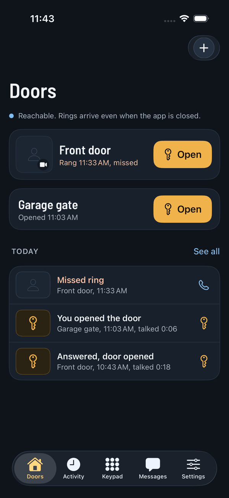
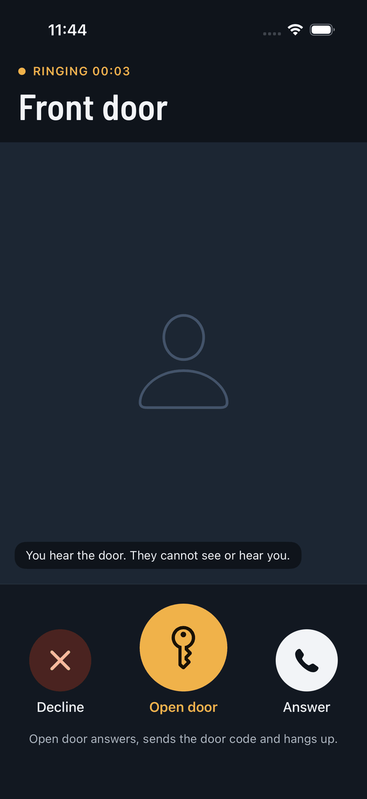
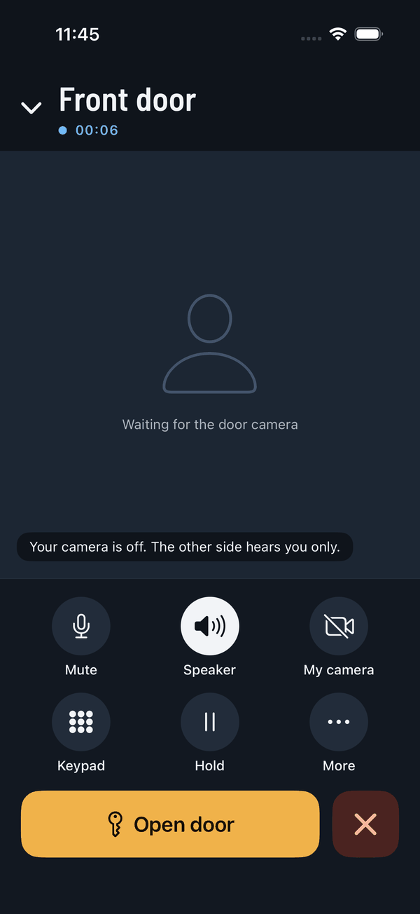
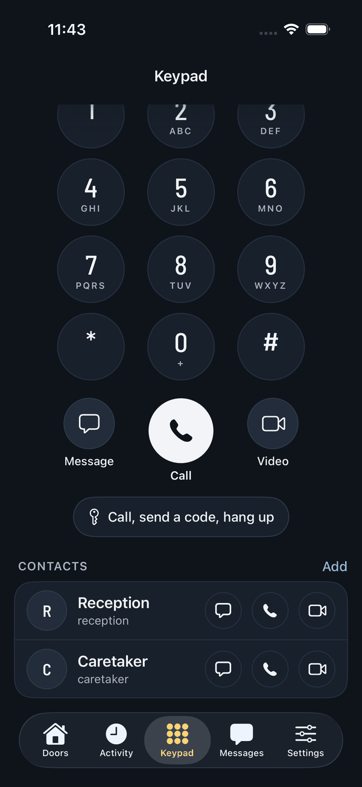

# BaresipKit

**A SIP kit for voice and video calls in mobile apps: Swift on iOS and macOS, Kotlin on Android,
one C core.**


BaresipKit wraps the [baresip](https://github.com/baresip/baresip) user agent and the
[libre](https://github.com/baresip/re) SIP stack behind a small, versioned C ABI, and puts two
SDKs with the same features and the same type names on top of it:

- **Swift** for iOS and macOS: `async`/`await`, with adapters for CallKit, LiveCommunicationKit,
  PushKit, the audio session and SwiftUI. The C core ships as an XCFramework inside a Swift
  package.
- **Kotlin** for Android: coroutines and `Flow`, with adapters for Telecom, Firebase Cloud
  Messaging, audio focus and Compose. The C core ships inside the libraries for `arm64-v8a`
  and `x86_64`.

On either platform an app goes from "register an account" to "answer a pushed video call on the
lock screen" with a few dozen lines of code.

> [!IMPORTANT]
> **Beta.** BaresipKit is in active development and has no release yet. The API can still
> change, and it is tested on a limited set of devices and SIP servers. Test it with your own
> setup before relying on it.

<p align="center">
  
  
  
  
</p>
<p align="center"><sub>Zvono, the sample app: an intercom built on BaresipKit, here on iOS, from CI's simulator test. <a href="Android/zvono/README.md">Zvono for Android</a> has the same screens.</sub></p>

## Contents

- [Setup](#setup)
- [Licensing](#licensing)
- [Highlights](#highlights)
- [Modules](#modules)
- [Features](#features)
- [Documentation](#documentation)
- [Repository layout](#repository-layout)
- [Contributing and security](#contributing-and-security)
- [License](#license)

## Setup

Pick your platform; each guide has the modules, requirements, installation, a quick start, the
setup recipes, an app checklist and the sample app.

| Platform | Language and tools | Setup guide | Sample app |
|---|---|---|---|
| iOS 16 or later; macOS 13 or later on Apple silicon (partial) | Swift 6, Xcode 16, Swift Package Manager | [iOS and macOS setup](Docs/iOS.md) | [Examples/SampleApp](Examples/SampleApp) |
| Android 9 or later (API 28) | Kotlin, coroutines, Gradle | [Android setup](Docs/Android.md) | [Android/zvono](Android/zvono/README.md) |

Both SDKs build the same C core with the same patches, so SIP, media and NAT behave the same on
both; only the layers that talk to the operating system differ.
[Docs/Platforms.md](Docs/Platforms.md) lists those differences, type by type and test by test.

## Licensing

BaresipKit and everything it ships are under permissive licenses (BSD and Apache 2.0, listed in
[THIRD_PARTY_NOTICES.md](THIRD_PARTY_NOTICES.md)), so a closed-source app can use it as it is.
H.264 patent licensing is the app publisher's; see [THIRD_PARTY_NOTICES.md](THIRD_PARTY_NOTICES.md).

## Highlights

- **Registration** over UDP, TCP and TLS, with private CAs, mutual TLS and SPKI pinning.
- **Audio** with Opus, G.722 and G.711; **video** with H.264 through the platform's codec
  (VideoToolbox on iOS, MediaCodec on Android) and VP8.
- **System call integration**: CallKit or LiveCommunicationKit on iOS, Telecom on Android. The
  adapters handle the hard parts: reporting a pushed call at once, matching it to the INVITE
  that follows, and waiting for the engine's result before completing a system action.
- **Push**: VoIP pushes through PushKit on iOS and Firebase Cloud Messaging on Android, with the
  push token kept current in the registration's `Contact` parameters.
- **UI state**: `BaresipPhone` and `BaresipPhoneCall` publish registrations, calls, mute, hold,
  video and DTMF to SwiftUI or Compose, with ready-made video and camera preview components.
- **Door stations and intercoms**: early media preview before answering, video in audio calls,
  picture updates over SIP INFO, DTMF door codes with a confirmation reply.
- **NAT traversal**: STUN, ICE with TURN over UDP, TCP and TLS, ICE restart, RTCP
  multiplexing and a NAT pinhole for media relays.
- **App life cycle**: going offline in the background and back online when the app becomes
  active, and re-registering after network changes.

## Modules

Each Swift product has a Kotlin library with the same role. Add only what your app uses; the
setup guides describe each one.

| Role | iOS and macOS (Swift product) | Android (Kotlin library) |
|---|---|---|
| Engine: accounts, calls, media, messages, events, logging, TLS, NAT, life cycle helpers | `BaresipKit` | `baresipkit` |
| Audio when no system call framework manages it | `BaresipKitAudio` (`AVAudioSession`) | `baresipkit-audio` (audio focus, `AudioManager`) |
| Remote video and the local camera | `BaresipKitVideo` (VideoToolbox, AVFoundation) | `baresipkit-video` (MediaCodec, OpenGL ES, Camera2) |
| System call screen and actions | `BaresipKitCallKit`, `BaresipKitLiveCommunication` | `baresipkit-telecom` (Jetpack core-telecom) |
| Incoming calls while the app is not running | `BaresipKitPushKit` | `baresipkit-push` (Firebase Cloud Messaging) |
| UI state | `BaresipKitSwiftUI` | `baresipkit-compose` |

## Features

"Supported" means in the API and covered by automated tests; the notes say where a feature has
also been tried on a physical device.

| Feature | iOS | Android | Notes |
|---|---|---|---|
| Registration over UDP, TCP and TLS | Supported | Supported | Tested against Asterisk and a TLS test registrar in CI |
| TLS with a private CA, mutual TLS and SPKI pinning | Supported | Supported | |
| Audio calls: Opus, G.722, G.711 | Supported | Supported | |
| Video calls with H.264 | Supported | Supported | VideoToolbox with zero-copy decoded frames on iOS, MediaCodec on Android; VP8 in the `full` module set on both |
| Hold, resume, mute, DTMF (RFC 4733 and SIP INFO) | Supported | Supported | DTMF with a confirmation reply for door stations |
| Several calls at once, switching the active call | Supported | Supported | `maxCalls` in the configuration |
| Blind and attended transfer (REFER, Replaces) | Supported | Supported | |
| SIP MESSAGE (RFC 3428) | Supported | Supported | |
| Early media preview of incoming calls | Supported | Supported | Receive-only 183 Session Progress, also video only |
| Door stations: video in audio calls, calls without audio, headers of incoming INVITEs | Supported | Supported | `video` only decides whether your camera is sent |
| Picture update requests over SIP INFO (RFC 5168) | Supported | Supported | For devices that ignore RTCP PLI/FIR |
| Camera preview, camera switching, video snapshots | Supported | Supported | `BaresipSelfView` on iOS, `BaresipCameraPreview` on Android |
| Choosing the audio output | Supported | Supported | Earpiece, loudspeaker, wired and Bluetooth headsets; car audio on iOS |
| SRTP (SDES) and DTLS-SRTP | Supported | Supported | |
| ICE with STUN and TURN over UDP, TCP and TLS, ICE restart | Supported | Supported | |
| RTCP multiplexing (RFC 5761) and a NAT pinhole for receive-only streams | Supported | Supported | For media relays such as rtpengine |
| Adaptive video bitrate from RTCP loss | Supported | Supported | |
| Going offline in the background, network change handling | Supported | Supported | `BaresipAppLifecycle`, `BaresipNetworkMonitor` on both |
| Call recording to stereo WAV | Supported | Supported | |
| Statistics: loss, jitter, RTT, MOS estimate | Supported | Supported | |
| File log with rotation | Supported | Supported | `BaresipFileLog`, secrets redacted |
| System call integration | Supported | Supported | CallKit and LiveCommunicationKit on iOS, tested on a device; Telecom on Android, tested on an emulator |
| Push for incoming calls | Supported | Supported | PushKit on iOS, tested on a device with VoIP pushes; Firebase Cloud Messaging on Android, not yet tried with Google's servers |
| UI state for SwiftUI and Compose | Supported | Supported | `BaresipPhone`, `BaresipPhoneCall` |
| Calls asked for by other apps | Supported | Supported | Recents on iOS; `sip:` and `tel:` intents on Android |
| SIP over secure WebSocket | Partial | Partial | Transport available in the API, not covered by tests |
| ZRTP, conferencing, presence, H.265 | Not supported | Not supported | |

macOS (Apple silicon) is partial: `BaresipKit`, `BaresipKitVideo` frames and
`BaresipKitSwiftUI` are built and unit-tested in CI but not tested in real calls, there is no
echo cancellation, and the audio session, CallKit and PushKit adapters and `BaresipVideoView` are
iOS only. On Android nothing has run on a physical device yet; CI runs the JVM tests against the
core and the sample app's UI tests on an emulator. What CI covers and what it does not is listed
in [Docs/Limitations.md](Docs/Limitations.md).

## Documentation

| Where | What |
|---|---|
| [Docs/iOS.md](Docs/iOS.md) | iOS and macOS setup: modules, installation, quick start, recipes, app checklist |
| [Docs/Android.md](Docs/Android.md) | Android setup: modules, installation, quick start, recipes, app checklist, building and releasing |
| DocC (Product > Build Documentation in Xcode) | The Swift API reference and articles |
| Dokka (`./gradlew :dokkaGeneratePublicationHtml` in `Android/`) | The Kotlin API reference |
| [Docs/Integration.md](Docs/Integration.md) | The full integration guide for the Swift package |
| [Docs/Platforms.md](Docs/Platforms.md) | How the platforms share the core, and parity type by type and test by test |
| [Docs/Architecture.md](Docs/Architecture.md) | Layers, threading and ownership on both platforms |
| [Docs/STABILITY.md](Docs/STABILITY.md) | What Semantic Versioning covers, enumerations that grow, deprecation and OS support |
| [Docs/C-ABI.md](Docs/C-ABI.md) | Conventions of the C ABI in `baresip_kit.h`, which both SDKs bind |
| [Docs/Troubleshooting.md](Docs/Troubleshooting.md) | Common failures and how to read the log for each |
| [Docs/Interop.md](Docs/Interop.md) | Servers, door stations and TURN servers BaresipKit has been tried with, and how to report yours |
| [Docs/Limitations.md](Docs/Limitations.md) | Known limits and what is not tested |
| [Docs/Building.md](Docs/Building.md), [Docs/Releasing.md](Docs/Releasing.md) | Building the XCFramework and the host core, CI, and cutting a release |
| [Docs/CompatibilityMatrix.md](Docs/CompatibilityMatrix.md) | Each requirement and how baresip covers it |
| [Patches/README.md](Patches/README.md) | The patches applied to baresip and libre, and why |

## Repository layout

```
Package.swift   Swift package; the C core is the BaresipKitCore binary target
Core/           the C facade (include/baresip_kit.h, src/), built into the XCFramework and the Android libraries
Sources/        BaresipKitBridge (C helpers), BaresipKit (Swift API) and the adapters
Tests/          BaresipKitTests (XCTest), Core (C tests), Fuzz, Integration (Asterisk and coturn)
Examples/       the iOS sample app (XcodeGen project)
Build/          pinned versions, module sets and the build script for the XCFramework and the Android core
Patches/        small patches applied to the pinned baresip and libre sources
Scripts/        lint.sh and format.sh
Android/        the Android libraries (Kotlin over JNI) and the Android sample, a Gradle project
Docs/           the setup guides for both platforms, the C ABI reference and research notes
Tools/          the Contact parameter proof, test registrars and the door stack
```

## Contributing and security

See [CONTRIBUTING.md](CONTRIBUTING.md) for building, testing and the commit convention, and
[SECURITY.md](SECURITY.md) for reporting vulnerabilities privately. This project follows the
[Contributor Covenant](CODE_OF_CONDUCT.md).

## License

BaresipKit is available under the BSD 3-Clause license; see [LICENSE](LICENSE). libre,
baresip, Opus and libvpx are BSD-3-Clause too. OpenSSL, built into the C core on both platforms
for TLS, DTLS-SRTP and crypto, is Apache License 2.0, which requires its NOTICE text to ship
with the app. The iOS release workflow bundles it, and every other license text, into
`BaresipKitCore-licenses.zip`; the texts are also in
[THIRD_PARTY_NOTICES.md](THIRD_PARTY_NOTICES.md).

H.264 is patent-encumbered. BaresipKit ships no H.264 code: it uses the platform's codec,
VideoToolbox on iOS, covered by Apple's platform license, and the device's MediaCodec codecs on
Android. Read the note in [DEPENDENCIES.md](DEPENDENCIES.md) before shipping; it also has the
full dependency inventory, with versions and roles.
